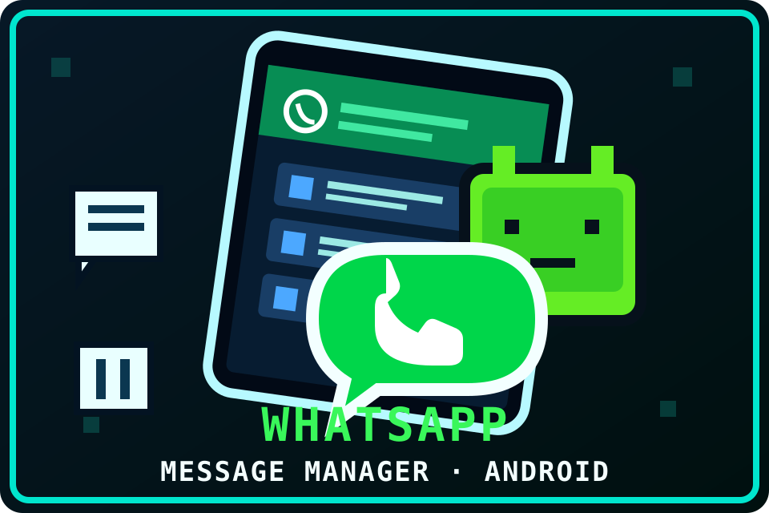

<!-- NX MATRIX · PIXEL EDITION -->

# ░▒▓ WHATSAPP MESSAGE MANAGER ▓▒░
### ANDROID COMPANION · NX MATRIX

**A pixel-inspired Android companion for your WhatsApp Message Manager dashboard.**

[ FEATURES ](#-features) · [ ARCHITECTURE ](#-architecture--hosting) · [ BUILD APK ](#-build-apk-from-github) · [ SETUP ](#-first-launch) · [ SECURITY ](#-security)

---

## ▣ PROJECT STATUS

This repository contains the Android Studio project for the NX Matrix WhatsApp Message Manager mobile companion. It opens the existing hosted Message Manager dashboard inside a native Android WebView.

> **Important:** This is the Android client only. WhatsApp Web authentication, QR pairing, contact storage, campaign processing, and message delivery are handled by the separately deployed Node.js backend.

## ▣ FEATURES

| MODULE | CAPABILITY |
|---|---|
| ▣ Backend Setup | Configure the HTTPS backend URL on first launch |
| ▣ Dashboard | Open the responsive web dashboard in a native Android WebView |
| ▣ Session | Retain dashboard cookies and session state on the device |
| ▣ Import | Import CSV files using Android's native file picker |
| ▣ Settings | Change the backend URL from the in-app Settings control |
| ▣ Navigation | Keep navigation inside the configured backend origin; external links open in the browser |

## ▣ ARCHITECTURE & HOSTING

The Android app is a mobile dashboard client. The backend must be deployed separately to a persistent host with:

- Node.js 20+
- Chromium/Puppeteer dependencies required by `whatsapp-web.js`
- HTTPS enabled
- Persistent storage for the `data/` directory, especially `data/session`
- Production secrets such as `APP_PASSWORD` and `SESSION_SECRET` configured as environment variables

**GitHub Pages cannot run the Node.js/WhatsApp backend.** This repository stores the Android source and builds a debug APK through GitHub Actions.

## ▣ BUILD APK FROM GITHUB

1. Open the **Actions** tab.
2. Select **Build Android APK**.
3. Choose **Run workflow**, or push a commit to `main` to trigger it automatically.
4. Open the completed workflow run and download the `message-manager-debug-apk` artifact.
5. Extract the artifact ZIP and install `app-debug.apk` on your Android device.

The workflow creates a debug APK for testing/sideloading. It is not a Play Store-signed release.

## ▣ BUILD LOCALLY

1. Install Android Studio and Android SDK Platform 35.
2. Open this repository as a project.
3. Allow Gradle sync to finish.
4. Select **Build → Build Bundle(s) / APK(s) → Build APK(s)**.
5. APK output: `app/build/outputs/apk/debug/app-debug.apk`.

## ▣ FIRST LAUNCH

1. Deploy the existing Node.js backend to a persistent host.
2. Configure `APP_PASSWORD` and `SESSION_SECRET` securely on that host.
3. Ensure HTTPS and persistent storage are enabled.
4. Open the Android app and enter the backend's HTTPS URL.
5. Sign in to the dashboard and connect WhatsApp using its QR login flow.

### ▸ QR PAIRING NOTE

If the QR code is displayed on the same Android phone that has WhatsApp installed, that phone generally cannot scan its own screen. Display the QR on a second device/computer, or use the official WhatsApp Business Platform for a supported production integration.

## ▣ SECURITY

- Never commit `data/`, WhatsApp session files, passwords, cookies, or contact exports.
- Use HTTPS only and restrict backend access to trusted users.
- Use campaigns only with recipients whose consent has been recorded.
- The app does not bypass WhatsApp messaging limits or platform policies.

---

**NX MATRIX** · IDEAS | INTELLIGENCE | IMPACT

PIXEL EDITION · WHATSAPP MESSAGE MANAGER · ANDROID

